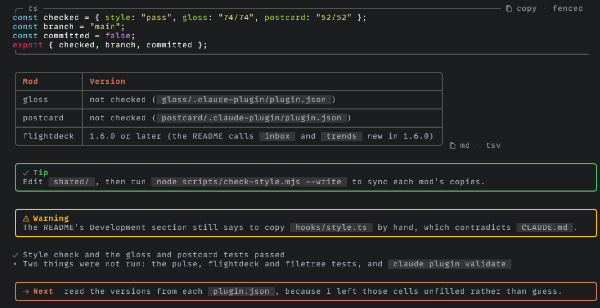
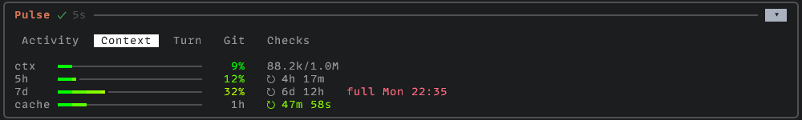
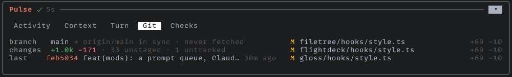
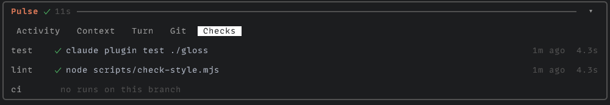
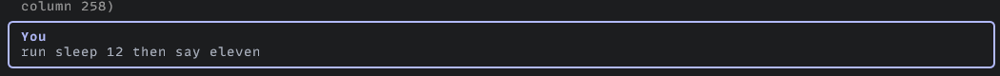
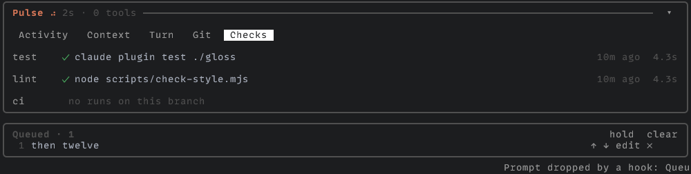
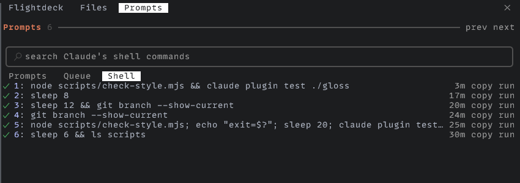
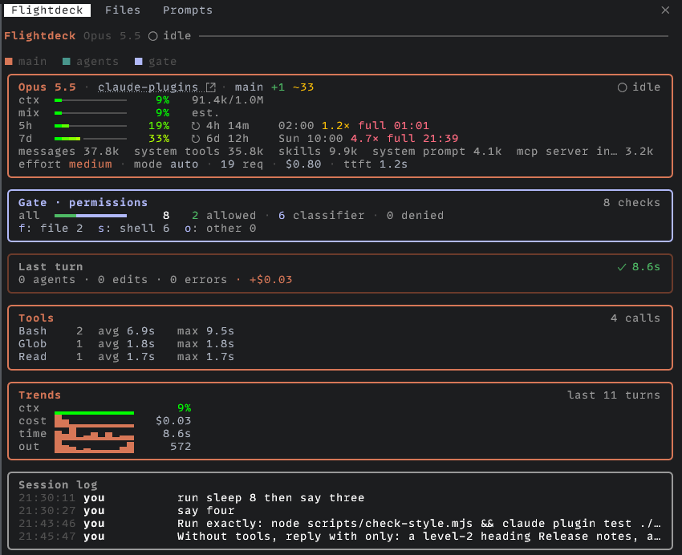
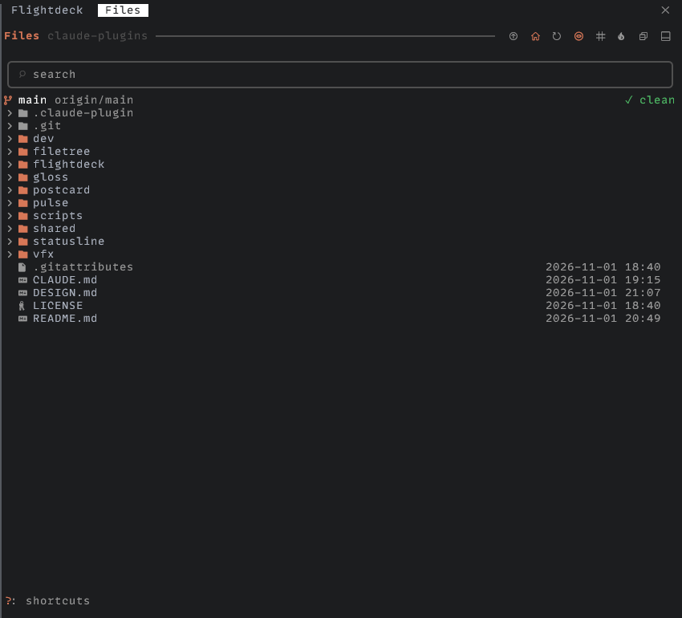
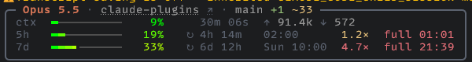

<div align="center">

  

  <h3 align="center">claude-plugins</h3>

  <p align="center">
    Claude Code plugins: mods that make the terminal easier to read, and version-pinned documentation skills for VFX and pipeline software.
    <br/><br/>
    <a href="https://claude.com/resources/articles/claude-code-mods"><strong>What are mods?</strong></a>
  </p>

  ##

  <p align="center">
    <!-- Maintenance status -->
    &nbsp;&nbsp;
    <!-- License -->
    &nbsp;&nbsp;
    <!-- Claude Code version -->
    &nbsp;&nbsp;
    <!-- Last Commit -->
    &nbsp;&nbsp;
    <!-- Commit Activity -->
    <a href="https://github.com/healkeiser/claude-plugins/pulse" alt="Activity">
      </a>&nbsp;&nbsp;
    <!-- GitHub stars -->
    
  </p>

</div>


<!-- TABLE OF CONTENTS -->
## Contents

- [At a glance](#at-a-glance)
- [Install](#install)
- [The mods](#the-mods): [gloss](#gloss) · [pulse](#pulse) · [postcard](#postcard) · [flightdeck](#flightdeck) · [filetree](#filetree)
- [Status line](#status-line)
- [One design](#one-design)
- [Skills](#dev-skills)
- [Security](#security)
- [Development](#development)
- [Credits and inspiration](#credits-and-inspiration)


<!-- GLANCE -->
## At a glance

Five [mods](https://claude.com/resources/articles/claude-code-mods) for [Claude Code](https://claude.com/claude-code), small TypeScript modules that redraw parts of its interface, and a matching status line. Install only the ones you want: each works on its own.

| Mod | In one line |
|-----|-------------|
| [**gloss**](#gloss) | Claude's replies, easier to read: code blocks with a copy button, tables, callouts, a `Next` box |
| [**pulse**](#pulse) | A band above the prompt: what Claude is doing now, and context, limits, git and checks at a glance |
| [**postcard**](#postcard) | Your prompts as cards, a queue for what you type while Claude works, and a pane to find any prompt or shell command again |
| [**flightdeck**](#flightdeck) | A dashboard pane: the model's vitals, permissions, subagents, tool timings, trends |
| [**filetree**](#filetree) | An IDE-style file tree of what Claude reads, writes and changes |

The screenshots are Windows Terminal with MonoLisa Nerd Font. The mods are for the terminal (the CLI) only: in the desktop app, VS Code and on mobile they draw nothing and open no pane, and those keep their own interface.


<!-- INSTALLATION -->
## Install

``` shell
claude plugin marketplace add healkeiser/claude-plugins
claude plugin install gloss@healkeiser --scope user
claude plugin install pulse@healkeiser --scope user
claude plugin install postcard@healkeiser --scope user
claude plugin install flightdeck@healkeiser --scope user
claude plugin install filetree@healkeiser --scope user
```

New sessions load them; in an open one, run `/reload-plugins`. Update with `claude plugin marketplace update healkeiser`, then `claude plugin update <mod>@healkeiser`.

> [!IMPORTANT]
> Mods need Claude Code **2.1.299** or later.


<!-- USAGE -->
## The mods

### gloss

<p align="center"></p>

Claude's replies in the terminal, restyled to read at a glance.

- **Code blocks** open-sided with their language, a `copy` button and a menu (as written, fenced, as one line); mermaid diagrams drawn as text.
- **Tables** in rounded frames, copyable as Markdown or TSV.
- **Callouts** (`> [!TIP]`, `[!WARNING]`, `[!NOTE]`, `[!IMPORTANT]`, `[!CAUTION]`) and the closing `Next:` line as boxes.
- **Inline code** as theme-aware chips, `file:line` references as links, nested lists, task items, quotes, rules, diffs in colour.

<details>
<summary>Options</summary>

| Option | Values | Default | What it does |
|---|---|---|---|
| `glyphs` | `auto` `plain` `text` `nerd` | `auto` | auto: Nerd Font icons in a terminal with a Nerd Font (3.2 or newer), the Unicode glyphs elsewhere. |

Set them with `/plugin`, the mod's Configure entry.

</details>

### pulse

<p align="center"></p>

A band above the prompt. While Claude works, one row says what it is doing; while it waits, the context, prompt cache and last turn. Unfold it (`▾`) for five tabs:

| Tab | Shows |
|-----|-------|
| **Activity** | Claude's plan as a progress meter (`3/7`, the step under way), then the turn's tool calls |
| **Context** | context and the 5h and 7d limits as heat meters, the prompt cache countdown, and `full 21:40` in red when a limit will fill before it resets |
| **Turn** | the last turn: time, tools by kind, edits, errors, cost |
| **Git** | branch, upstream and `⇡ahead ⇣behind`, last fetch, stash, worktrees; lines changed and staged, unstaged, untracked files; the last commit; commits this session; a rebase or merge under way; the most changed files |
| **Checks** | the last test, type check, lint and build Claude ran, with how each ended; the branch's GitHub Actions runs and pull request (with `gh`), and a toast when a run finishes |

<p align="center"></p>

<p align="center"></p>

It also folds runs of tool calls into one line (`◇ 3 reads · ⌕ 2 searches`), draws shell commands as compact rows, and closes each turn with a summary. `/pulse band on|off` shows or hides the band.

<details>
<summary>Options</summary>

| Option | Values | Default | What it does |
|---|---|---|---|
| `motion` | `while-active` `off` | `while-active` | while-active: the band's spinner and the Bash rows' turn while Claude works, and a new action fades in. |
| `band` | `on` `off` | `on` | on: the band above the prompt shows at all times, folded to one row until you unfold it. |
| `glyphs` | `auto` `plain` `text` `nerd` | `auto` | auto: Nerd Font icons in a terminal with a Nerd Font (3.2 or newer), the Unicode glyphs elsewhere. |

Set them with `/plugin`, the mod's Configure entry.

</details>

### postcard

<p align="center"></p>

Your prompts as cards: blue for a prompt, purple for a slash command.

**A queue for what you type while Claude works** (off by default: set `queue` to `postcard`). Send a prompt with `ctrl+x enter` (Claude Code's *queue* key) and it waits above the prompt instead of in Claude Code's own queue, where you can reorder it (`↑ ↓`), take it back to edit, drop it (`✕`), or `hold` the whole queue. The next one goes when the turn ends; after you interrupt Claude, the queue holds until you resume it. It survives a restart, held.

<p align="center"></p>

**`/prompts`** opens a pane to search every prompt you sent, jump back to it in the transcript, re-send or edit it; a **Queue** tab; and a **Shell** tab of the commands Claude ran, to copy or run again (`run` puts `!command` in the prompt box, it never runs anything itself). `/prompts prev` and `next` step between prompts.

<p align="center"></p>

<p align="center"></p>

> [!NOTE]
> Enter and send-now (`ctrl+x ctrl+s`, `ctrl+enter`) stay Claude Code's own, untouched. Slash commands, prompts with `@file` mentions or pasted images, and prompts typed within a second of the one before still go to Claude Code's own queue: a plugin's prompt cannot expand mentions or images, and the very first keystrokes after Enter reach Claude Code before any mod. A prompt the queue sends shows in the transcript as *Prompt from the postcard plugin*: Claude Code always names who sent a prompt. Set `queue` to `engine` to leave every prompt to Claude Code.

<details>
<summary>Options</summary>

| Option | Values | Default | What it does |
|---|---|---|---|
| `queue` | `postcard` `engine` | `engine` | postcard: a prompt you send with `ctrl+x enter` while Claude works waits in a queue above the prompt, where you can reorder, edit, remove or hold it; the next one is sent when the turn ends, and the queue holds after an interrupt. |
| `glyphs` | `auto` `plain` `text` `nerd` | `auto` | auto: Nerd Font icons in a terminal with a Nerd Font (3.2 or newer), the Unicode glyphs elsewhere. |

Set them with `/plugin`, the mod's Configure entry.

</details>

### flightdeck

<p align="center"></p>

A live dashboard beside the transcript (`/flightdeck`; `ctrl+x tab` focuses it).

- **Main**: the model, folder and branch; context, its estimated mix, and the 5h and 7d limits as heat meters with pace and forecast; effort, mode, requests, cost and time to first token.
- **Gate**: every permission check, who decided it (you, a rule, the classifier) and what it was.
- **Agents**: subagent cards side by side, swimlanes past a few; an on-call **architect** (an advisor agent) when one runs.
- **Tools**: per tool, its calls, average and slowest time and failures; a call that waited on your answer is not timed.
- **Turn**, **Trends** (sparklines over the last turns), **Inbox** (failures and refusals, a row jumps to its call) and the **Session log**.

Blocks sit edge to edge; while work flows, packets run along the bottom edge of the block it flows from. A restyled fork of [Flightdeck](https://github.com/scasella/claude-flightdeck).

<details>
<summary>Options</summary>

| Option | Values | Default | What it does |
|---|---|---|---|
| `architectPattern` | string | `advisor|architect` | Regular expression (case-insensitive) for the agent types and server tools that count as the on-call architect, e.g. |
| `architectLabel` | string | `Architect` | Name shown for the architect role. |
| `gateLabel` | string | `Gate` | Name shown for the permission panel. |
| `panels` | string | `main,architect,gate,inbox,agents,loops,receipt,tools,trends,log` | Comma-separated panels in display order: main, architect, gate, inbox, agents, loops, receipt, tools, trends, log. |
| `motion` | `while-active` `off` | `while-active` | Animate the connectors while real work flows, or keep them still. |
| `moments` | boolean | `True` | Show the inferred moment of each consult (before a plan, error repeats, before done). |
| `matchDescriptions` | boolean | `False` | Also count an agent type as the architect when its description (not just its name) matches the pattern. |
| `maxCards` | number | `3` | Agent cards drawn side by side; more agents than this switch to swimlanes (1-6). |
| `paneColumns` | number | `66` | Columns the pane asks for when docked beside a fullscreen transcript, 40 or more. |
| `layout` | `auto` `compact` `wide` `mini` | `auto` | auto: a summary of at most 8 rows when the pane sits inline above the prompt, two columns from 110 columns when docked, one column otherwise. |
| `glyphs` | `auto` `plain` `text` `nerd` | `auto` | auto: Nerd Font icons in a terminal with a Nerd Font (3.2 or newer), the Unicode glyphs elsewhere. |
| `palette` | `theme` `pastel` | `theme` | theme follows your Claude Code theme (light, dark, colour-blind); pastel is fixed colours tuned for dark terminals. |
| `openOnStart` | boolean | `True` | Open the pane when a session starts. |
| `statusLine` | boolean | `False` | Show context, agents, consults and denials in the status line. |

Set them with `/plugin`, the mod's Configure entry.

</details>

### filetree

<p align="center"></p>

An IDE-style file tree pane (`/filetree`): what Claude reads, writes and changes shimmers as it happens; git status and line counts per file; an edit heat count; a preview split with syntax highlighting, images, PDFs and office documents; a treemap of folder sizes; diffs by Claude Code's own diff view; and Markdown before and after. Nerd Font icons when a Nerd Font is installed. A restyled fork of [data-goblin/claude-code-filetree](https://github.com/data-goblin/claude-code-filetree).

<details>
<summary>Options</summary>

| Option | Values | Default | What it does |
|---|---|---|---|
| `activity` | `reads and writes` `writes` `reads` `none` | `reads and writes` | Which of Claude's file activity shimmers in the tree: files read with the Read tool or Bash readers (rg, grep, find, cat) in purple, writes in orange and git actions in green. |
| `motion` | `while-active` `off` | `while-active` | while-active: Claude's activity shimmers across the names it touches and a running git action spins. |
| `glyphs` | `auto` `nerd` `plain` `text` | `auto` | Icon set: auto uses Nerd Font icons when Nerd Fonts 3.2 or newer is installed here, and plain Unicode otherwise; plain uses Unicode only; text is plain with the header buttons as words (up, cwd, sync, dots, size, fold, split, clear), falling back to plain glyphs when the pane is too narrow. |
| `follow` | `on` `off` | `on` | on: the tree scrolls to what Claude reads, writes or commits. |
| `start` | `on` `off` | `on` | on: the pane opens when a session starts. |
| `focus` | `on` `off` | `on` | on: /filetree moves the keyboard into the tree when it opens it. |
| `column` | `date` `age` `size` `loc` | `date` | What the right column shows by default: date (last modified), age (time since last modified, short: now, 12m, 3h, 5d, then Oct 9 past a week and the year past a year), size (files in bytes, folders as disk usage computed in the background) or loc (non-blank lines in code, markup, config and docs files, folders as the sum, counted in the background; pictures, video, binaries and data files show nothing). |
| `heat` | `session` `sessions` `off` | `session` | How often Claude edited or wrote each file (Edit, Write, NotebookEdit), shown as a short heat meter and count beside the git status, folders summing their files; the header button shows only the hot files, hottest first. |
| `hints` | `on` `off` | `on` | on: outside a git repo, a line under the header says git status starts after git init. |
| `spacing` | `on` `off` | `on` | on: a blank line above and below the search bar. |
| `shortcuts` | `auto` `always` `off` | `auto` | auto: the footer shows a ?: shortcuts hint until you press ? in the tree, then the shortcuts show at the left of the footer row for 10 seconds, the selected entry staying at the right; ? again hides them. |
| `open` | string | - | What a double-click or Enter does with a file. |
| `binaries` | `Open with` `default app` | `Open with` | What a double-click or Enter does with an image, audio, video, PDF, office document, archive, font or compiled file when Open with names an editor or command. |
| `edit` | string | - | What e does in the preview: open the file at the top line shown. |
| `diff` | string | - | What d does on a changed file, in the tree or the preview. |
| `target` | `auto` `pane right` `pane below` `tab` `workspace` | `auto` | Where Open with: editor, e in the preview and a Diff with command start their terminal program inside tmux or herdr. |
| `ignore` | string | - | File and folder names to leave out of the tree, its search and its shimmer, separated by spaces or commas. |
| `split` | `bottom` `top` | `bottom` | Where the split preview of the file under the cursor sits when the header button or p shows it: bottom (under the tree, above the status line) or top (under the header). |
| `treemap` | `auto` `image` `cells` `off` | `auto` | What the split preview shows on a folder. |
| `palette` | string | - | Your own colors, laid over the Omarchy, light or default theme: key=#hex pairs separated by spaces. |

Set them with `/plugin`, the mod's Configure entry.

</details>


<!-- STATUSLINE -->
## Status line

<p align="center"></p>

`statusline/statusline.sh` draws the status line as the same rounded card: the model, folder and branch, then a heat meter each for the context window and the 5-hour and 7-day limits, with their reset, pace (`1.0×` finishes the window at exactly 100%) and, when a limit will fill before it resets, `full 21:40`.

Copy it into `~/.claude/` and point `statusLine` at it in `~/.claude/settings.json`:

``` json
"statusLine": {
  "type": "command",
  "command": "bash ~/.claude/statusline.sh"
}
```

It needs `bash` 4.2+, `jq` and `git` (on Windows, Git Bash has all but `jq`; on macOS, install a newer `bash`). `STATUSLINE_THEME=light` suits a light background; `NO_COLOR` drops colour; given `COLUMNS`, it drops the clock, pace and token counts, then details, to fit.


<!-- DESIGN -->
## One design

All five mods and the status line share one design: the same colour roles, glyphs, header, tabs, search bar, meters and motion, in [DESIGN.md](./DESIGN.md). It is written once, in `shared/` (`style.ts` for tokens and formats, `kit.tsx` for the components), and copied into each mod, since a plugin cannot import from another. The `glyphs` option of every mod draws Nerd Font icons where a Nerd Font is installed (`auto`), the Unicode set (`plain`), or ASCII (`text`).


<!-- DEV -->
## Dev skills

The `dev` plugin holds coding-convention skills, shown as `dev:<skill>`.

| Skill | What it covers |
|-------|----------------|
| `dev:python` | Python conventions: package layout, type hints, docstrings, imports, comments, formatting (ruff/black), `pyproject.toml`, tests |

``` shell
claude plugin install dev@healkeiser --scope user
```


<!-- SKILLS -->
## Documentation skills

The `vfx` plugin holds one skill per release of each piece of software, named `<software>-<version>` (Kitsu's docs have no versions, so its skill is plain `kitsu`), so they all show up as `vfx:<skill>`. Each skill tells Claude how to search and cite that release's official docs, and ships a crawler that builds a local Markdown copy of them.

| Skill | Sources |
|-------|---------|
| `vfx:openusd-26-11` | openusd.org 26.11 (user docs and API guide pages), the USD Survival Guide |
| `vfx:unreal-5-8` | Unreal Engine 5.8 documentation (without the generated API reference) |
| `vfx:rez-3-4` | rez 3.4.0: user guide, `rez-*` CLI pages, Python API |
| `vfx:deadline-10-4` | Deadline 10.4 User Manual, Scripting Reference, Standalone Python Reference |
| `vfx:blender-5-2` | Blender 5.2 LTS manual and Python API, Blender developer docs |
| `vfx:houdini-22` | Houdini 22.0 help (nodes, VEX, HOM, Solaris, Karma, PDG…) and the HDK guide pages |
| `vfx:cinema4d-2027` | Cinema 4D 2027 user manual and Python SDK 2027.0.0 |
| `vfx:kitsu` | Kitsu developer docs (Zou, gazu, integrations, self-hosting) and the Zou REST API from its OpenAPI spec; unversioned, the crawl records the Zou and gazu versions |

``` shell
claude plugin install vfx@healkeiser --scope user
```

The docs themselves are not in this repository: they belong to their publishers. A skill builds its copy the first time it is used, into the plugin's data folder (`~/.claude/plugins/data/`), where it survives plugin updates. Uninstalling the plugin deletes it unless you pass `--keep-data`. Each crawler fetches exactly its release and refuses any other version.

Requirements: [uv](https://docs.astral.sh/uv/) for the crawlers. `rez-3-4` also needs `git`, because it builds the docs from the rez release tag. `houdini-22` builds its help from an installed Houdini 22.0 (sidefx.com's robots.txt disallows crawling the versioned docs), found via `$HFS` or SideFX's default install path.


<!-- SECURITY -->
## Security

Mods are not sandboxed: they run with Claude Code's own access to your machine. Read `hooks/` before installing, as for any plugin. What each one does beyond drawing:

| Mod | Runs | Reads | Network |
|-----|------|-------|---------|
| gloss | nothing | nothing | none |
| postcard | nothing | its own store (the queue) | none |
| pulse | `git` read-only (status, diff, log, rev-list, worktree list), `gh run list` and `gh pr view` | the session's usage, `.git` marker files | `gh` talks to GitHub |
| flightdeck | `git status`, `git remote get-url` | the session's usage | none |
| filetree | `git`, and preview converters (`ffmpeg`, `pdftoppm`, `soffice`) when installed; opens files in the programs its options name | the folder it shows, font folders | none |

Every command runs by argument vector with no shell, git with `--no-optional-locks` so it never takes the index lock, and none runs while drawing. flightdeck redacts credentials from the tool inputs it keeps. The `vfx` skills run no hooks; their crawlers fetch the docs sites listed above and write only inside the plugin's data folder.


<!-- DEVELOPMENT -->
## Development

``` shell
git clone https://github.com/healkeiser/claude-plugins
cd claude-plugins
claude --plugin-dir ./gloss --plugin-dir ./pulse --plugin-dir ./postcard --plugin-dir ./flightdeck --plugin-dir ./filetree
```

A session started with `--plugin-dir` reloads a mod each time you save it. Each mod is a plugin folder: `.claude-plugin/plugin.json`, `hooks/hooks.json`, the hooks module `hooks/register.tsx` and its tests.

The design lives in `shared/`: edit it there, never in a mod's copy, then copy it out and check:

``` shell
node scripts/check-style.mjs --write   # copy shared/ into every mod
node scripts/check-style.mjs           # fails on a drifted copy, a hand-drawn search bar or card, an emoji-capable glyph
claude plugin test ./pulse             # each mod's tests
claude plugin validate ./pulse
```


<!-- CREDITS -->
## Credits and inspiration

- **flightdeck** is a fork of [Flightdeck](https://github.com/scasella/claude-flightdeck) by Stephen Casella (MIT), with contributions from Alejandro Remior, @vihrea1337, Da Vinci and the people credited in its changelog. See [`flightdeck/NOTICE`](./flightdeck/NOTICE).
- **filetree** is a fork of [claude-code-filetree](https://github.com/data-goblin/claude-code-filetree) by [Kurt Buhler](https://github.com/data-goblin) (MIT), with its contributors listed in [`filetree/ACKNOWLEDGEMENTS.md`](./filetree/ACKNOWLEDGEMENTS.md).
- **gloss**: lists by depth, task items, quote bars, rules, strikethrough and theme-aware chips were inspired by [cc-crayon](https://github.com/jonpojonpo/cc-crayon) by jonpojonpo (ideas only, no code taken).
- Measuring text in terminal cells, with CJK and emoji two cells wide, follows [prismantis](https://github.com/NahumLitvin/prismantis) by Nahum Litvin (idea only).
- The status line's `NO_COLOR` support and its narrow forms follow [claude-powerline](https://github.com/Owloops/claude-powerline) and [ccstatusline](https://github.com/sirmalloc/ccstatusline) (ideas only).


<!-- LICENSE -->
## License

MIT. See [LICENSE](./LICENSE).

> [!NOTE]
> Claude and Claude Code are trademarks of Anthropic. These mods are an independent community project and are not affiliated with, endorsed by, or sponsored by Anthropic.


<!-- CONTACT -->
## Contact

Project Link: [claude-plugins](https://github.com/healkeiser/claude-plugins)

<p align='center'>
  <!-- GitHub profile -->
  <a href="https://github.com/healkeiser">
    </a>&nbsp;&nbsp;
  <!-- LinkedIn -->
  <a href="https://www.linkedin.com/in/valentin-beaumont">
    </a>&nbsp;&nbsp;
  <!-- Behance -->
  <a href="https://www.behance.net/el1ven">
    </a>&nbsp;&nbsp;
  <!-- X -->
  <a href="https://twitter.com/valentinbeaumon">
    </a>&nbsp;&nbsp;
  <!-- Instagram -->
  <a href="https://www.instagram.com/val.beaumontart">
    </a>&nbsp;&nbsp;
  <!-- Gumroad -->
  <a href="https://healkeiser.gumroad.com/subscribe">
    </a>&nbsp;&nbsp;
  <!-- Gmail -->
  <a href="mailto:valentin.onze@gmail.com">
    </a>&nbsp;&nbsp;
  <!-- Buy me a coffee -->
  <a href="https://www.buymeacoffee.com/healkeiser">
    </a>&nbsp;&nbsp;
</p>
